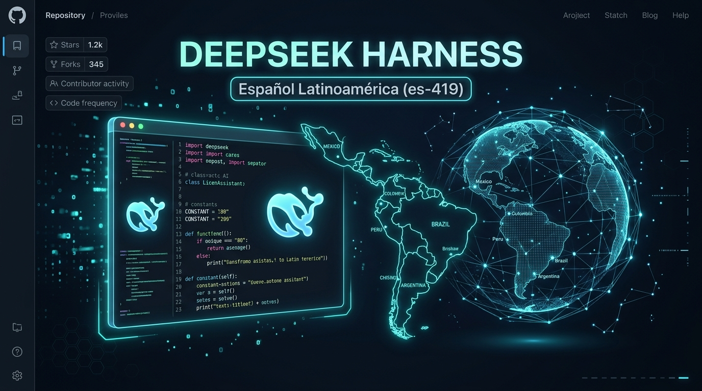
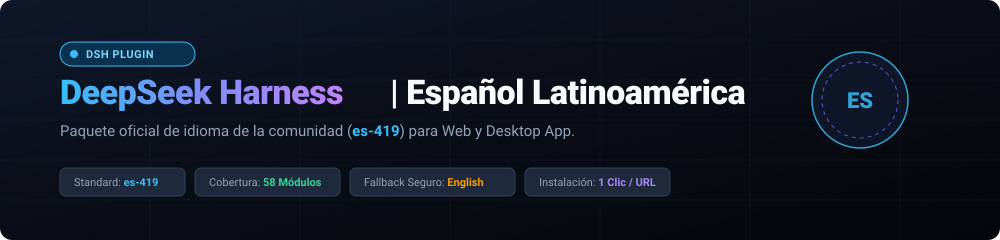
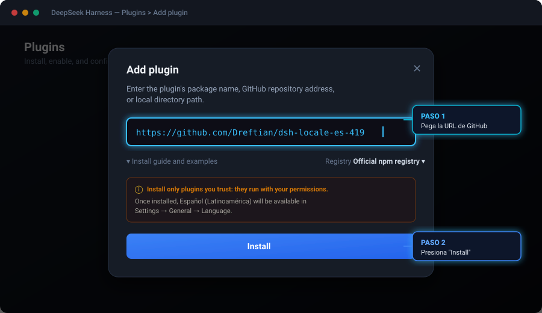
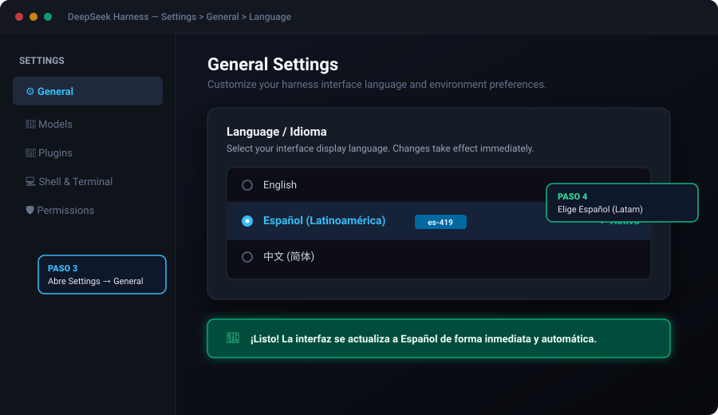

<p align="center">
  
</p>

<p align="center">
  
</p>

<p align="center">
  <a href="https://github.com/Dreftian/dsh-locale-es-419/stargazers"></a>
  <a href="https://github.com/Dreftian/dsh-locale-es-419/network/members"></a>
  <a href="https://github.com/Dreftian/dsh-locale-es-419/blob/main/LICENSE"></a>
  <a href="https://github.com/topics/dsh-plugin"></a>
</p>

<p align="right"><strong>Español</strong> | <a href="#english">English</a></p>

---

# dsh-locale-es-419

Paquete de idioma **Español (Latinoamérica) - `es-419`** para la interfaz web y desktop de [DeepSeek Harness](https://github.com/deepseek-ai/deepseek-harness).

Este plugin comunitario registra el idioma `es-419` en el selector de idiomas de la configuración (**Settings → General → Language** / **Configuración → General → Idioma**) y suministra 58 diccionarios traducidos con terminología adaptada a América Latina (por ejemplo: *archivo* en lugar de *fichero*, *computadora*, *configuración*, *guardar*, *cancelar*, *detener*).

---

## 📸 Guía visual paso a paso de activación

### Paso 1: Abrir "Add plugin" e ingresar la dirección del repositorio

En la app de DeepSeek Harness (Desktop o Web), dirígete a la sección **Plugins** en la barra lateral y haz clic en el botón superior derecho **`+ Add plugin`**.

En el cuadro de texto que aparece:

<p align="center">
  
</p>

> **¿Qué debes escribir en el campo de texto?**  
> Copia y pega exactamente esta URL:
> ```text
> https://github.com/Dreftian/dsh-locale-es-419
> ```
> *(También puedes usar el atajo `github:Dreftian/dsh-locale-es-419` o la ruta de tu carpeta local).*

---

### Paso 2: Presionar "Install"

Haz clic en el botón **`Install`** al pie de la ventana modal. DeepSeek Harness descargará y registrará automáticamente el plugin `dsh-locale-es-419`.

---

### Paso 3 & 4: Cambiar el idioma en Configuración

Una vez instalado:
1. Abre **Settings** (Configuración) desde la barra lateral o presiona `Ctrl + ,` (`Cmd + ,` en macOS).
2. Selecciona la pestaña **General**.
3. En la fila **Language** (Idioma), haz clic y selecciona **Español (Latinoamérica)**.

<p align="center">
  
</p>

🎉 **¡Listo!** Toda la interfaz se adaptará de inmediato a español latinoamericano y la preferencia quedará guardada de forma permanente para tus próximas sesiones.

---

## ⚡ Instalación alternativa por terminal (CLI)

Si prefieres instalarlo mediante la línea de comandos de `dsh`:

### Para la interfaz Web:

```bash
# Mediante enlace directo al repositorio:
git clone https://github.com/Dreftian/dsh-locale-es-419.git
cd dsh-locale-es-419
dsh plugin --profile web add link:$(pwd)
```

En **Windows (PowerShell)**:
```powershell
git clone https://github.com/Dreftian/dsh-locale-es-419.git
cd dsh-locale-es-419
dsh plugin --profile web add link:(Get-Location).Path
```

### Para la aplicación Desktop:

```bash
dsh plugin --profile desktop add link:$(pwd)
```

En **Windows (PowerShell)**:
```powershell
dsh plugin --profile desktop add link:(Get-Location).Path
```

---

## 🌟 Características clave

| Característica | Detalle |
|---|---|
| **Estándar BCP 47 (`es-419`)** | Reconocimiento automático para navegadores y sistemas operativos de Latinoamérica (México, Colombia, Argentina, Perú, Chile, etc.). |
| **Terminología neutra** | Vocabulario natural para la región: *archivo*, *computadora*, *configuración*, *guardar*, *cancelar*, *detener*. |
| **58 Módulos cubiertos** | Cobertura integral: chat, workspace, terminal, modelos, configuración, atajos de teclado, subagentes y herramientas. |
| **Fallback resiliente a inglés (`en`)** | Cualquier función nueva o texto pendiente recurre de forma segura a inglés, evitando errores en la UI. |
| **Persistencia duradera** | Tu selección se guarda en `$DSH_HOME/cordis.patch.yml` bajo la clave `locale.preference`. |

---

## 🤝 Cómo contribuir

¡Las contribuciones de toda la comunidad hispanohablante son bienvenidas!

1. Los diccionarios editables están en [`locale/es-419/*.json`](locale/es-419/).
2. Reconstruye el paquete con:
   ```bash
   npm run build
   ```
3. Envía un Pull Request con tus mejoras y ajustes de traducción.

---

<a id="english"></a>
## 🌐 English

**dsh-locale-es-419** is an open-source community language pack plugin providing Latin American Spanish (`es-419`) localization for [DeepSeek Harness](https://github.com/deepseek-ai/deepseek-harness).

### Quick Install

In DeepSeek Harness:
1. Go to **Plugins** → **+ Add plugin**.
2. Enter:
   ```text
   https://github.com/Dreftian/dsh-locale-es-419
   ```
3. Click **Install**.
4. Open **Settings → General → Language** and pick **Español (Latinoamérica)**.

---

## 📄 Licencia

[MIT](LICENSE) © 2026 Dangelo Vilchez ([@Dreftian](https://github.com/Dreftian))
